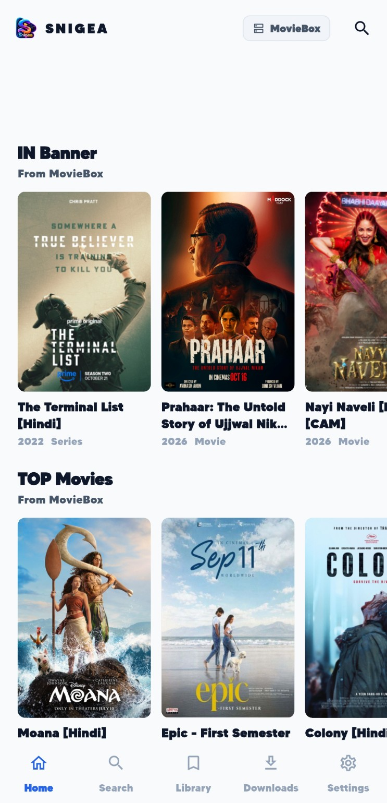
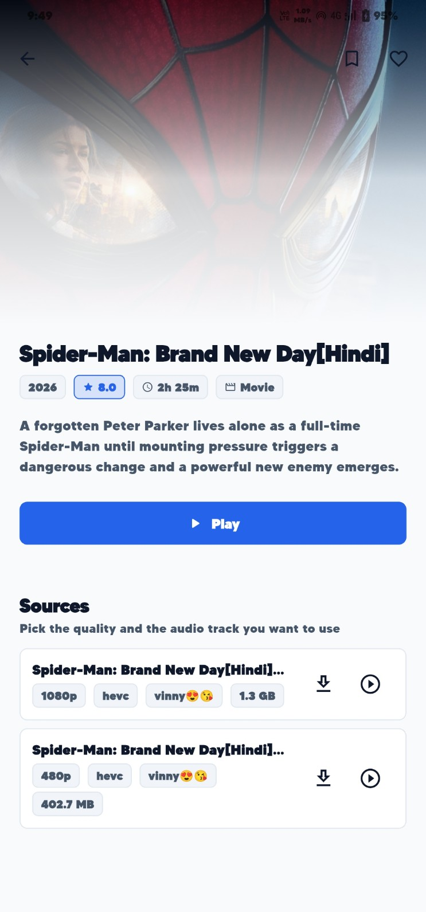
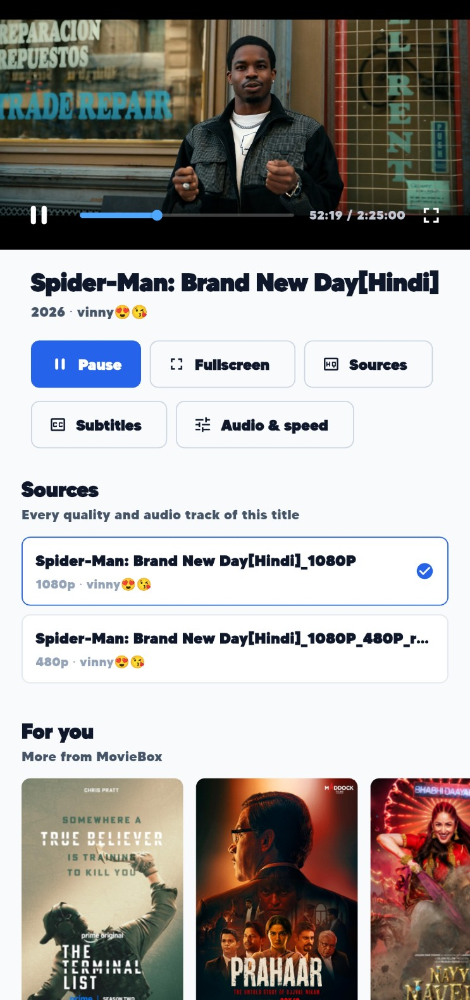
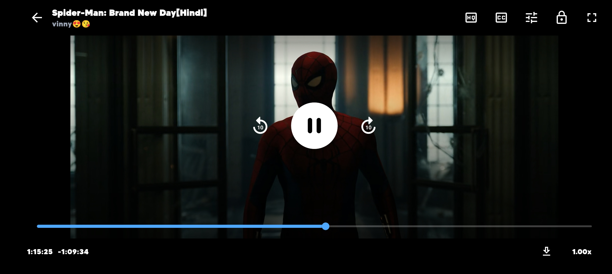
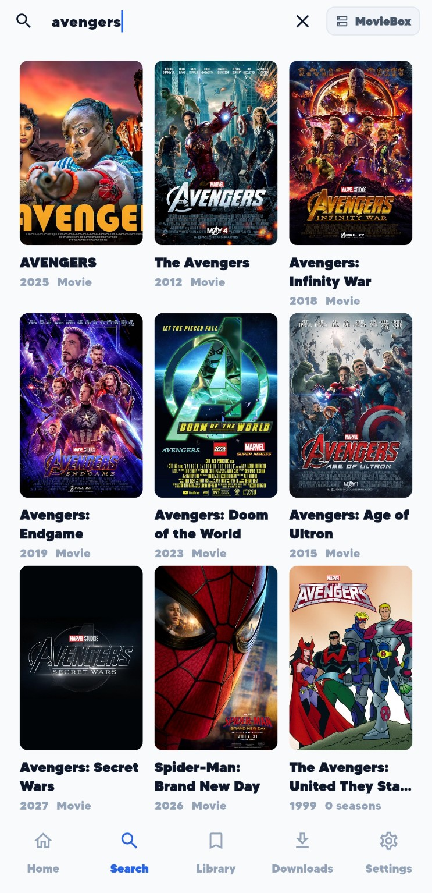
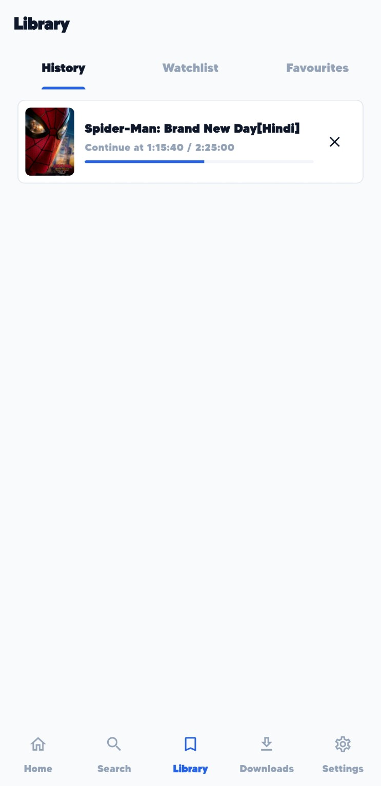
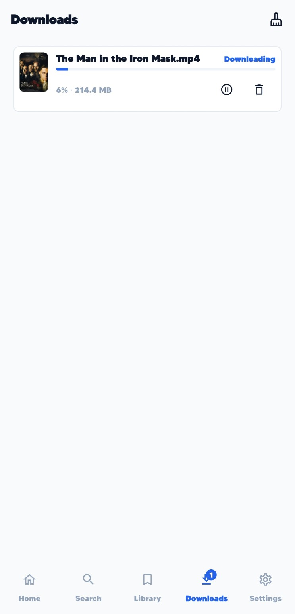
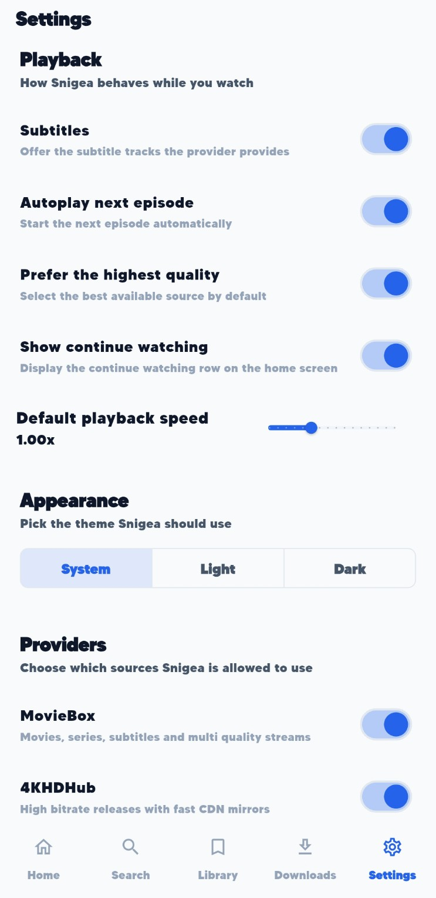

<div align="center">


<h1>Snigea</h1>

<p><strong>Snigea is a premium, open source movie and TV streaming client built with Flutter.</strong><br>
It connects directly to the public streaming providers from your device — MovieBox, 4KHDHub,
Dramachi, the BDIX local mirrors and every Stremio addon — and keeps your watchlist, favourites,
history, downloads and playback progress in a local SQLite database.</p>

<p>
<a href="https://github.com/MurShidM01/snigea/releases/latest"></a>
<a href="https://github.com/MurShidM01/snigea/releases"></a>
<a href="https://murshidm01.github.io/snigea/"></a>
<a href="https://github.com/MurShidM01/snigea/actions/workflows/ci.yml"></a>
<a href="https://github.com/MurShidM01/snigea/actions/workflows/release.yml"></a>
<a href="https://github.com/MurShidM01/snigea/actions/workflows/pages.yml"></a>
</p>

<p>
<a href="https://github.com/MurShidM01/snigea/releases/latest"></a>
<a href="https://murshidm01.github.io/snigea/"></a>
</p>

<p>
<a href="https://img.shields.io/badge/Flutter-3.47.7-02569B?logo=flutter&logoColor=white"></a>
<a href="https://img.shields.io/badge/Dart-3.13.5-0175C2?logo=dart&logoColor=white"></a>
<a href="https://img.shields.io/badge/License-MIT-green.svg"></a>
<a href="https://img.shields.io/badge/License-Apache_2.0-blue.svg"></a>
<a href="https://img.shields.io/badge/platform-Android%20%7C%20iOS%20%7C%20macOS%20%7C%20Windows%20%7C%20Linux%20%7C%20Web-lightgrey?logo=flutter"></a>
</p>

</div>

---

## Table of contents

- [Highlights](#highlights)
- [Screenshots](#screenshots)
- [Download and install](#download-and-install)
- [Streaming providers](#streaming-providers)
- [Features](#features)
- [Architecture](#architecture)
- [Local database](#local-database)
- [The player](#the-player)
- [The download manager](#the-download-manager)
- [Cross platform support](#cross-platform-support)
- [Continuous integration and delivery](#continuous-integration-and-delivery)
- [Publishing a release](#publishing-a-release)
- [Contributing](#contributing)
- [Development](#development)
- [Verification](#verification)
- [FAQ](#faq)
- [Credits and acknowledgements](#credits-and-acknowledgements)
- [License and disclaimer](#license-and-disclaimer)

---

## Highlights

- **No backend, no account, no tracking.** Every request goes from the device straight to the
  provider. Everything you own is stored in a local SQLite database that only you can read.
- **One codebase for every platform.** Android, iOS, macOS, Windows, Linux and the web, all
  written in pure Dart. No Kotlin, no Swift, no C, no FFI, no custom native code.
- **An embedded player.** `media_kit` renders the video inside the app, with an inline player,
  an immersive fullscreen mode, swipe to seek, swipe for the volume, subtitles, audio tracks,
  playback speed and source switching.
- **A real download manager.** Parallel HTTP range downloads with resume, pause, live progress
  and integrity checks — the download list keeps moving while the file is fetched.
- **A flat, premium interface.** Light theme, dark theme and system mode, hairline borders
  instead of shadows, a 4 pixel spacing grid and a single restrained accent colour.
- **Release automation.** Continuous integration, signed GitHub releases and an automatic
  deployment to GitHub Pages.

## Screenshots

| Home | Details |
| :---: | :---: |
|  |  |
| The catalogue of every provider in themed rows. | The synopsis, the metadata, the sources and the episodes. |

| Inline player | Fullscreen player |
| :---: | :---: |
|  |  |
| The video with the actions, the sources and the recommendations. | The immersive player with the seek bar, the skip buttons and the lock. |

| Search | Library | Downloads | Settings |
| :---: | :---: | :---: | :---: |
|  |  |  |  |
| The search across the providers with the filter. | The history, the watchlist and the favourites. | The live progress of every download. | The playback, the theme and the providers. |

> These are real screenshots of the application on a device.

---

## Download and install

### Android

1. Open the [latest release](https://github.com/MurShidM01/snigea/releases/latest).
2. Download `Snigea-<version>-<build>-android-universal.apk`. It contains the native libraries
   for every Android architecture, so it runs on any phone.
3. Copy it to the phone and open it. Android asks for the permission to install unknown
   applications, which is expected for every sideloaded APK.
4. Verify the download with the published `SHA256SUMS.txt` if you want to be sure.

> **Updates need the same key.** Android only accepts an update when the new APK carries the
> same application id (`com.aliedu.app.snigea`) **and** is signed with the same key as the
> installed application. The releases are signed with one fixed community key, so every release
> can update the previous one. An installation that was signed with a different key cannot be
> updated in place: it has to be uninstalled first, and the local data is lost with it.

> **Community signing, not a Play Store release.** The key is a shared community key for
> sideloading and community distribution. It is not a Play Store signing key, the app is not
> published on the Play Store, and it is not intended for commercial distribution.

### Web

The web build is deployed automatically to GitHub Pages on every push to `main`:

```
https://murshidm01.github.io/snigea/
```

The catalogue, the search, the details and the library work in the browser. The local database
uses the SQLite WebAssembly build, so the whole history and the watchlist are available there
too. Downloads and background work are not available in a browser.

### iOS

There is **no signed IPA**, because the project has no Apple Developer membership, no Apple
signing certificate and no provisioning profile. A Mac user builds and signs the app with their
own Apple Account:

1. Install the Flutter SDK `3.47.7`, run `flutter pub get` in the repository.
2. Run `open ios/Runner.xcworkspace`, Xcode opens the project.
3. Select the `Runner` target, open the `Signing & Capabilities` tab.
4. Tick `Automatically manage signing` and choose your own Apple Account as the team.
5. Connect your iPhone or iPad, pick it as the run destination and press `Run`.

> **The free Personal Team profile is limited.** The signing certificate expires after seven
> days, the app has to be rebuilt and reinstalled afterwards, and the provisioning limit is
> three apps per device and per seven days.

---

## Streaming providers

Snigea integrates the same providers as the reference implementation this project was ported
from, with the same endpoints, request signing, parsing rules and stream resolution:

| Provider | What it provides | Notes |
| :--- | :--- | :--- |
| **MovieBox** | Movies, series, seasons, subtitles and multi quality HTTP streams | Requests are signed with the upstream HMAC-MD5 scheme (`x-client-token`, `x-tr-signature`, `x-client-info`, `x-forwarded-for`). The `play-info` endpoint answers with the *site trailer* (a 23 second placeholder that is identical for every title), so the real media is read from the `resourceDetectors` block of the subject details, from the exact-episode `resource/v2` listing and — when the listing still points at the placeholder — from the `resource-position/v2` failover API. The recovered links carry a time limited signature and are refreshed right before the playback starts. |
| **4KHDHub** | High bitrate releases with CDN mirrors | The HTML pages are parsed with the documented class names; HubCloud, HubDrive and GreenMotors mirrors are resolved, probed with a range request and ranked. |
| **Dramachi** | Asian dramas and series | Uses the `search`, `title_v2`, `eplist` and `getFile` interfaces of the nodeobjects API. |
| **CircleFTP (BDIX)** | Local high speed mirror | Only reachable from a BDIX peering network. |
| **DhakaFlix (BDIX)** | Local file index | Only reachable from a BDIX peering network. |
| **Stremio addons** | Community catalogues, metadata and streams | Addons are installed by their manifest URL; Cinemeta is pre-installed. |

Every provider is implemented in pure Dart under `lib/providers/`.

### Permissions

| Platform | Permission | Why |
| :--- | :--- | :--- |
| Android | `INTERNET` | Snigea streams from the upstream providers. |
| Android | `ACCESS_NETWORK_STATE` | Used to detect that the device is online. |
| Android | `usesCleartextTraffic` | The BDIX mirrors are only reachable over plain HTTP inside the local ISP network. |
| iOS / macOS | `NSAllowsArbitraryLoads`, `NSAllowsLocalNetworking` | Same reason: the BDIX mirrors use plain HTTP. |
| iOS / macOS | `NSLocalNetworkUsageDescription` | Required by iOS before the local network may be used. |

---

## Features

- **Home** — the catalogue of every provider, arranged in the categories of the provider
  (trending, popular, movies, series, TV shows) with an infinite scroll.
- **Search** — a live search across the enabled providers with a provider filter, plus a
  fallback that searches the local database when the provider is unreachable.
- **Details** — posters, synopsis, cast, season and episode lists, audio track and subtitle
  filters, the episode list with the watched markers and the "For you" recommendations.
- **Library** — history, watchlist and favourites in three tabs, with the resume position of
  every title.
- **Downloads** — a live download list with the progress, the speed, pause, resume, cancel and
  delete, and the remaining space.
- **Player** — the inline player, the immersive fullscreen player, the source sheet, the
  subtitle and the audio track sheet, the speed control, the automatic next episode and the
  resume prompt.
- **Settings** — the theme (light, dark, system), the provider switches, the provider base
  URLs, the download directory and the cache controls.
- **Widgets** — a flat design system with hairline borders, tonal surfaces, small corner radii
  and a consistent 4 pixel spacing grid.

---

## Architecture

```
lib/
├── main.dart                 # Entry point, media_kit initialisation
├── app.dart                  # MaterialApp.router and the theme
├── core/                     # Cross cutting helpers
│   ├── crypto/               # MD5, HMAC-MD5, tolerant base64
│   ├── json/                 # Helpers for loosely typed provider payloads
│   ├── logging/              # Sanitised logging (no credentials, no query strings)
│   ├── network/              # Dio factory, timeouts, retry policy, user agents
│   ├── platform/             # File store abstraction (native / web)
│   ├── text/                 # Title, size, year and subtitle helpers
│   └── theme/                # The dark design system
├── data/
│   ├── database/             # Drift schema, connections and migrations
│   ├── models/               # Immutable domain models
│   └── repositories/         # Persistence per aggregate
├── providers/                # The provider clients and their parsers
├── services/                 # Catalogue, playback, download and settings services
├── state/                    # Riverpod providers and controllers
├── features/                 # The screens
├── routing/                  # go_router configuration
└── widgets/                  # Reusable design system widgets
```

- **State management**: Riverpod (`flutter_riverpod` 3.x). Screen state lives in
  `AsyncNotifier` / `Notifier` classes, database streams are exposed through `StreamProvider`s
  and services are plain classes injected through providers.
- **Persistence**: Drift (SQLite). The schema lives in `lib/data/database/tables.dart`, the
  migrations in `lib/data/database/app_database.dart`.
- **Playback**: `media_kit` with the embedded `Video` widget. No external player is launched;
  every source is opened inside the app.
- **Routing**: `go_router` with a shell route for the bottom navigation and a detail route for
  every content type.

---

## Local database

| Table | Purpose | Unique key |
| :--- | :--- | :--- |
| `saved_titles` | Favourites and watchlist (`kind` = `favourite` / `watchlist`) | kind, provider, subject id, media type |
| `playback_progress` | Playback position, duration and completion flag | provider, subject id, season, episode |
| `watched_episodes` | Episodes that were watched to the end | provider, subject id, season, episode |
| `search_history` | Previously issued queries | – |
| `settings` | User preferences (key/value) | key |
| `provider_configs` | Per provider enable flag and base URL | provider |
| `metadata_cache_entries` | Cached provider payloads with an expiry | cache key |
| `download_records` | Download tasks, progress, target file and integrity | – |

The schema is versioned. A migration that adds a column is part of the schema version, so an
existing installation keeps its history when the app is updated.

---

## The player

The player is embedded in the app: `media_kit` renders the video into a `Texture`, so no
external player is launched. The screen offers the controls of the large streaming apps:

- it opens as an inline player: the video with its controls, the actions, every source and a
  "For you" row of recommendations below, exactly like the inline player of the streaming apps.
  A tap on the fullscreen button turns it into the immersive landscape player,
- auto-hiding gradient overlays, a large play button and a ten second skip,
- a seek bar with the elapsed and the remaining time,
- the source, subtitle and speed sheets, a next episode button and a download button,
- horizontal swipes seek ten seconds at a time, a vertical swipe on the lower half changes the
  volume,
- double tap seeking and an in-app subtitle renderer for the external caption files of MovieBox,
- a lock that hides every control until the screen is unlocked again.

The video output is always sized to the aspect ratio that the decoder reports. A video surface
that fills the whole window makes Android reject every video buffer, which shows a black screen
while the audio keeps playing.

The controller is keyed by the title, so every screen owns its own media engine and the engine
is released as soon as the screen is closed. A failing engine is reported in the error overlay
instead of crashing the screen.

---

## The download manager

The downloads are written into the application support directory of the platform
(`<app>/files/Snigea/Downloads` on Android). No storage permission is needed, because the app
only ever writes into its own sandbox.

The download engine (`lib/services/download_engine.dart`) is a HTTP range downloader with the same
behaviour as the reference implementation:

- up to four attempts with exponential backoff,
- a `.part` file plus a `.part.json` resume document so that an interrupted download continues
  where it stopped,
- parallel range requests for files of 8 MiB or more (4 to 16 segments). The workers share a
  single file handle, so the writes are serialised through a lock — a file handle has one shared
  position and concurrent writes would corrupt the file,
- a live progress stream, so the bar of the download list moves while the file is fetched, and
  the progress is written to the database as well,
- pause (the partial file is kept and the download continues later), cancellation, deletion and
  the cleanup of leftover partial files,
- a fallback to a single request when the server does not serve ranges,
- size verification before the partial file is renamed to the final file.

The download resolves the source before the transfer starts: a 4KHDHub mirror is a resolver page
and the MovieBox links carry an expiring signature, so the real media file is fetched first. The
number of running downloads is shown as a badge on the navigation bar.

Downloads are only offered for sources that are ordinary media files. DASH manifests are played,
but they are **not** downloaded, because a segmented DASH download would require a media muxer
that is not available in pure Dart.

---

## Cross platform support

| Target | Status |
| :--- | :--- |
| Android | Fully supported, published as a signed APK and as an App Bundle. |
| iOS | Fully supported, but the build has to be signed with your own Apple Account on a Mac. |
| macOS | Fully supported. |
| Windows | Fully supported. |
| Linux | Fully supported, but the build host needs the mpv client library because `media_kit` links against libmpv: `sudo apt install libmpv-dev` (Debian/Ubuntu) or `sudo dnf install mpv-devel` (Fedora). The Flutter build itself needs the usual `clang`, `cmake`, `ninja` and `GTK 3` development packages. |
| Web | The catalogue, search and library work. The local database uses the SQLite WebAssembly build (`assets/sqlite3.wasm`) and the drift worker (`assets/drift_worker.js`), both shipped as regular Flutter assets so that no platform folder has to be modified. Downloads and background work are not available in a browser. |

The web build needs the two drift assets to be served with their correct MIME types
(`application/wasm` and `text/javascript`), which GitHub Pages, every standard static file
server and the Flutter development server do.

---

## Continuous integration and delivery

Three GitHub Actions workflows build and ship the project. Every third party action is pinned to
an immutable commit SHA.

| Workflow | Trigger | What it does |
| :--- | :--- | :--- |
| [`.github/workflows/ci.yml`](https://github.com/MurShidM01/snigea/blob/main/.github/workflows/ci.yml) | Push and pull request on `main`, manual | `flutter pub get`, the formatting check, `flutter analyze`, `flutter test`, a production web build and a release Android build. It never needs a signing secret, so a pull request from a fork runs it without any permission. |
| [`.github/workflows/release.yml`](https://github.com/MurShidM01/snigea/blob/main/.github/workflows/release.yml) | A version tag `v*`, manual | Validates the tag against `pubspec.yaml`, builds the signed Android APK and App Bundle on Ubuntu, builds the unsigned iOS archive on macOS, verifies the APK signature and publishes the GitHub Release with the checksums and the release notes. |
| [`.github/workflows/pages.yml`](https://github.com/MurShidM01/snigea/blob/main/.github/workflows/pages.yml) | Push on `main`, manual | Builds the production web bundle with the correct base path and deploys it to GitHub Pages with the official Pages actions. A pull request only validates the bundle, it never deploys. |

### Repository secrets

The release workflow needs four secrets. They are only read inside the release job, which is
triggered by a tag, so a pull request can never reach them.

| Secret | Value |
| :--- | :--- |
| `ANDROID_KEYSTORE_BASE64` | The base64 encoded keystore file. |
| `ANDROID_KEY_ALIAS` | The alias of the signing key inside the keystore. |
| `ANDROID_KEY_PASSWORD` | The password of the signing key. |
| `ANDROID_STORE_PASSWORD` | The password of the keystore. |

Create the keystore once and keep it safe — every release is signed with it, and an update of
the installed app only works with the same key:

```bash
keytool -genkeypair -v \
  -keystore snigea-release.jks \
  -alias snigea \
  -keyalg RSA -keysize 2048 -validity 10000 \
  -storetype JKS

base64 -w 0 snigea-release.jks > snigea-release.jks.b64
```

Store the content of `snigea-release.jks.b64` as `ANDROID_KEYSTORE_BASE64`. Keep the original
`snigea-release.jks` in a password manager: if it is lost, the published releases can never be
updated in place any more.

### What the release workflow guarantees

- The version in `pubspec.yaml` is the single source of truth. A tag that does not match it is
  rejected, and the workflow never rewrites `pubspec.yaml`.
- The `applicationId` `com.aliedu.app.snigea` and the version code from `pubspec.yaml` are
  checked in the generated APK before anything is published.
- The APK signature is verified with `apksigner` before the release is created.
- The signing material is deleted from the runner even when a step fails.
- The keystore is never attached to a release and no secret is ever printed in the log.
- The iOS build cannot block the Android release, but a failed iOS build is reported honestly in
  the release notes and its log is attached.

---

## Publishing a release

1. Update the version in `pubspec.yaml`:

   ```yaml
   version: 1.0.2+13
   ```

   The part before the `+` is the application version, the part after it is the build number.
   The build number has to increase for every upload, otherwise the store and the updater reject
   the build.

2. Commit and merge the change into `main`.

3. Push the matching tag:

   ```bash
   git tag v1.0.2
   git push origin main
   git push origin v1.0.2
   ```

4. The release workflow validates the tag, builds the assets and publishes the release on the
   [releases page](https://github.com/MurShidM01/snigea/releases).

A tag that does not match the version in `pubspec.yaml`, a malformed tag or an existing release
are all rejected without publishing anything.

---

## Branding and launcher icons

The launcher icon of every platform is generated from a single source image,
`assets/icon/Snigea.png`:

```bash
dart run flutter_launcher_icons     # Android, iOS, macOS, Windows and the web
dart run tool/generate_logo_asset.dart   # the small variant that the app bar draws
```

| Platform | Output |
| :--- | :--- |
| Android | `mipmap-{mdpi,hdpi,xhdpi,xxhdpi,xxxhdpi}/ic_launcher.png`, the adaptive icon `mipmap-anydpi-v26/ic_launcher.xml` with the background `#09090B` and the foreground in `drawable-*/ic_launcher_foreground.png`. |
| iOS | `AppIcon.appiconset` with every size from 20 to 1024 pixels, flattened without an alpha channel as Apple requires. |
| macOS | `AppIcon.appiconset` with the sizes from 16 to 512 pixels. |
| Windows | `windows/runner/resources/app_icon.ico`. |
| Web | `favicon.png` and `icons/Icon-{192,512}.png` plus the maskable variants. |
| Linux | The Flutter template draws the default icon, the platform folder has no icon resource. |

The application itself draws `assets/icon/snigea_logo.png` next to the wordmark in the app bar
and in the navigation rail.

---

## Contributing

Pull requests are welcome, but they follow strict rules. The full guide is in
**[CONTRIBUTING.md](CONTRIBUTING.md)**:

- every change arrives as a pull request against `main`, never as a direct push,
- the branch is named `<type>/<short-description>`, for example `feat/player-speed`,
- the title is `<type>(<scope>): <description>`, for example
  `feat(player): add the speed control`,
- the [pull request template](.github/pull_request_template.md) is filled in
  completely, the pipeline rejects a pull request with a missing section or an
  empty checklist,
- `flutter analyze` reports no issue, `dart format` changes nothing and
  `flutter test` passes,
- every new behaviour has a test and every fixed defect has a regression test,
- no secret, no keystore, no native code and no build output is ever committed,
- the version in `pubspec.yaml` and the release tags belong to the maintainer.

The rules are not only documented, they are enforced:

```bash
PR_TITLE="feat(player): add the speed control" \
PR_BRANCH="feat/player-speed" \
PR_BODY="$(cat .github/pull_request_template.md)" \
bash tool/check_pull_request.sh
```

Defects and ideas are reported with the templates of
[`.github/ISSUE_TEMPLATE`](.github/ISSUE_TEMPLATE). A security problem is
reported privately to the maintainer, never in a public issue.

---

## Development

```bash
flutter pub get
dart run build_runner build          # regenerate the drift code
dart format lib test
flutter analyze
flutter test
flutter build apk --release
flutter build web --release
flutter build linux --release
```

### Building on a small machine

The generated `android/gradle.properties` asks for a Gradle daemon with `-Xmx8G`. On a machine
with less memory the daemon is killed by the operating system before the build finishes. The
setting can be overridden from the environment without touching the platform folder:

```bash
GRADLE_OPTS="-Dorg.gradle.jvmargs=-Xmx2g -XX:MaxMetaspaceSize=768m" \
  flutter build apk --release --target-platform android-arm64
```

### Signing a local Android release

The Gradle configuration reads `android/key.properties` when the file exists and falls back to
the debug key when it does not, so a local release build always works. To sign a local build
with the community key, create the file:

```properties
storePassword=the-store-password
keyPassword=the-key-password
keyAlias=snigea
storeFile=/absolute/path/to/snigea-release.jks
```

`android/key.properties`, `*.jks` and `*.keystore` are ignored by Git and must never be
committed.

---

## Verification

| Check | Result |
| :--- | :--- |
| `flutter analyze` | no issues |
| `flutter test` | 136 tests, all passing |
| `flutter build web --release --base-href /snigea/` | succeeds, the base path is applied to `index.html` |
| `flutter build apk --release` | succeeds, 109.5 MB universal APK with `libmpv.so` and `libsqlite3.so`, the launcher icon and the logo of the application |
| `apksigner verify` on the release APK | verifies, APK Signature Scheme v2, the version name `1.0.1` and the version code `12` are checked with `aapt2` |
| `dart run tool/live_provider_check.dart` | verifies the live MovieBox API (session, search, details, releases) |

The live provider check only prints metadata and host names; it never prints a session token or
a signed URL.

Two more live checks exercise the stream resolution end to end and request real media bytes from
the CDN:

```bash
dart run tool/live_stream_check.dart Dune          # movies, sizes and HTTP probes
dart run tool/live_episode_check.dart "Breaking Bad"  # series episodes
dart run tool/live_provider_streams.dart            # MovieBox, 4KHDHub and Dramachi
```

---

## FAQ

**Does Snigea host or upload any content?**
No. The app only resolves public provider endpoints and plays what they publish. It has no
backend, no account system and no telemetry.

**Does the app need an internet connection?**
Yes, for everything except the already downloaded files. The BDIX mirrors additionally require a
connection to the local internet provider network.

**Can I use the app on several devices with the same library?**
No. The database is local to the device. There is no sync.

**Why does a provider sometimes show "find no content"?**
The MovieBox catalogue endpoints currently answer a visitor session with HTTP 406 *"find no
content"*, while the homepage endpoint still returns the full catalogue. Snigea shows the
homepage rows and reports the provider error with an explanation instead of an empty screen. The
4KHDHub, Dramachi and the Stremio addon providers are unaffected.

**Can I publish my own fork on the Play Store?**
The published APK uses a shared community key. For a store release, generate your own upload key
and your own Play signing key, and change the `applicationId` if the id is not yours.

---

## Credits and acknowledgements

Snigea is a Flutter port of the provider logic of
**[MovieBox-Tui](https://github.com/mesamirh/MovieBox-Tui)**
by [mesamirh](https://github.com/mesamirh), the terminal interface to find,
download and stream movies, TV shows and live TV. The request signing, the
parsing rules, the mirror ranking and the upstream fixes of the pull requests
[#208](https://github.com/mesamirh/MovieBox-Tui/pull/208) and
[#216](https://github.com/mesamirh/MovieBox-Tui/pull/216) were ported from it.
Without that project there would be no Snigea.

The application builds on Riverpod, go_router, Dio, Drift, media_kit, the
SQLite WebAssembly build of sqlite3.dart and the packages of the Dart team.
The complete list with the licence of every package, of every provider and of
every asset is in **[CREDITS.md](CREDITS.md)**.

## License and disclaimer

Snigea is **dual licensed**: you may use it under the terms of the
**Apache License 2.0** *or* the **MIT licence**, at your option.

| | |
| :--- | :--- |
| Apache License 2.0 | the full text in [LICENSE](LICENSE) |
| MIT licence | the full text in [LICENSE-MIT](LICENSE-MIT) |
| the notice and the attributions | [NOTICE](NOTICE) |

The third party components keep their own licences, they are listed in
[CREDITS.md](CREDITS.md).

Snigea does not host or store any media. It plays streams that the upstream providers publish.
Please respect the copyright of the content you access and the terms of the providers you use.

The provider names and logos belong to their respective owners, this project is not
affiliated with them.
